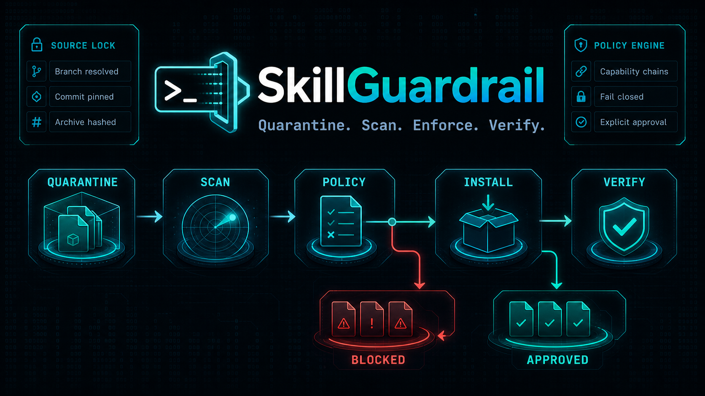
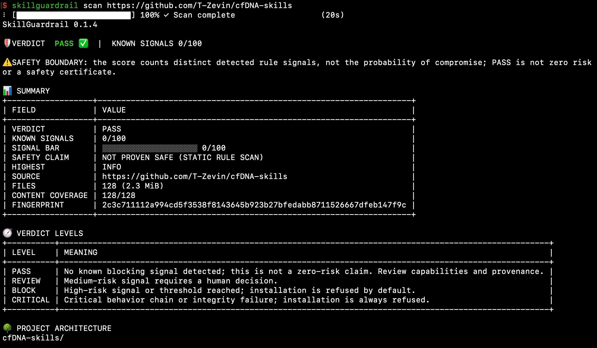
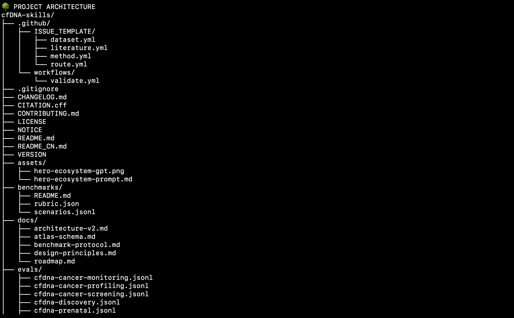
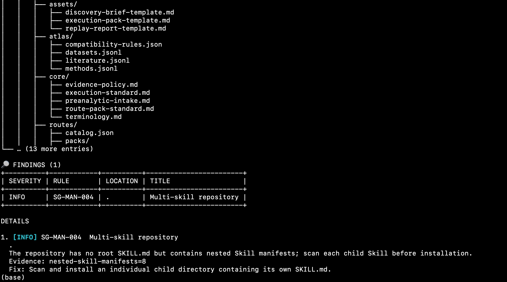

<h1 align="center">SkillGuardrail</h1>

<p align="center">
  <a href="README.md">简体中文</a> · English
</p>

<p align="center">
  <a href="https://github.com/T-Zevin/SkillGuardrail/actions/workflows/ci.yml"></a>
  <a href="https://github.com/T-Zevin/SkillGuardrail/releases"></a>
  <a href="https://github.com/T-Zevin/SkillGuardrail/releases"></a>
  <a href="go.mod"></a>
  <a href="LICENSE"></a>
  <a href="#platform-support"></a>
</p>



**Do not copy a GitHub Skill straight into your agent. Quarantine, scan, decide, then install.**

SkillGuardrail is an open-source pre-install security scanner and guarded installer for Agent Skills used by Codex, Claude Code, Cursor, Gemini CLI, and OpenClaw. It inspects untrusted packages without running package code, produces an explainable policy verdict, and binds approved installs to a source commit, package fingerprint, and external receipt.

> [!IMPORTANT]
> `PASS` means the enabled rules found no known blocking signal. It is not a safety certificate or a zero-risk claim. Keep unknown Skills sandboxed, least-privileged, and human-reviewed.

| Quarantine first | Policy verdict | Verifiable installs |
|:---|:---|:---|
| Never execute package scripts, interpreters, or hooks while inspecting. | Combine rule signals and capability chains into `PASS / REVIEW / BLOCK / CRITICAL`. | Detect drift from the source and fingerprint that were reviewed. |

## Why SkillGuardrail?

A Skill is more than Markdown: it can introduce instructions, scripts, dependencies, network access, and external content into an agent's trust boundary. SkillGuardrail checks prompt injection, secret access, network egress, remote downloads, dangerous commands, persistence, obfuscation, binaries, and capability chains such as **sensitive read + network egress** or **decode + execute**.

```text
untrusted source → private quarantine → static scan → policy verdict → explicit approval → atomic install → later verification
```

See the [rule catalog](docs/rules.md) and [threat model](docs/threat-model.md) for scope and limitations.

## Install

```bash
# Homebrew (macOS / Linux)
brew install T-Zevin/tap/skillguardrail

# Or source installation (Go 1.23+)
go install github.com/T-Zevin/SkillGuardrail/cmd/skillguardrail@latest
```

Release binaries and `checksums.txt` are available from [GitHub Releases](https://github.com/T-Zevin/SkillGuardrail/releases).

### Platform support

Scanning and reports work on macOS, Linux, and Windows. Guarded `install` and `verify` are currently enabled on macOS and Linux; Windows users can scan first and manually install reviewed files.

## Quick start

```bash
# Scan a local Skill
skillguardrail scan ./my-skill

# Scan a public GitHub repository
skillguardrail scan https://github.com/owner/repository

# JSON or SARIF for CI
skillguardrail scan ./my-skill --format json
skillguardrail scan ./my-skill --format sarif --output skillguardrail.sarif

# Guarded install into Codex after an explicit decision
skillguardrail install https://github.com/owner/repository --target codex --yes

# Detect later changes to an installed Skill
skillguardrail verify skill-name --target codex
```

Remote sources are resolved to an immutable commit and downloaded into a private quarantine. Interactive terminals show progress; use `--timeout 25m` on slow networks. Public GitHub HTTPS repository roots are supported directly when they contain a root Skill or exactly one nested Skill.

## Verdicts

| Verdict | Meaning | Default action |
| --- | --- | --- |
| `PASS` | No known blocking signal; not a zero-risk claim | Continue only after reviewing provenance and capabilities |
| `REVIEW` | Medium-risk capability or accumulated signals need a decision | Require explicit review |
| `BLOCK` | A High signal or risk threshold was reached | Refuse guarded installation |
| `CRITICAL` | A critical behavior chain or integrity failure was found | Always refuse |

The score counts distinct detected rule signals. It is **not** a probability of compromise. Guarded installation fails closed when a scan is incomplete.

## Usage examples

The following examples scan [`T-Zevin/cfDNA-skills`](https://github.com/T-Zevin/cfDNA-skills). `PASS` means no known blocking signal matched the enabled rules; it does not prove this repository safe.

```bash
skillguardrail scan https://github.com/T-Zevin/cfDNA-skills
```

### Summary: verdict, coverage, and fingerprint

<p align="center">
  
</p>

### Project architecture: what was actually inspected

<p align="center">
  
</p>

### Multi-Skill repositories: information, not a malicious verdict

<p align="center">
  
</p>

`SG-MAN-004` is informational: scan and install a specific child Skill instead of treating a normal multi-Skill repository as one portable package.

## 1,100+ cross-domain benchmark

SkillGuardrail is building a reproducible public Skill benchmark across biomedical research, social science and literature review, software engineering/DevOps, ML/data, quantitative finance, and professional automation.

- Current pilot: 108 research and cfDNA Skills pinned to exact commits;
- Release target: at least 1,100 public Skills;
- Every non-`PASS` result requires a human-review disposition;
- Reports will be stratified by domain and source repository; a rule hit will never be presented as proof of malicious intent.

See the [benchmark method](benchmarks/README.md) and [1,100+ roadmap](benchmarks/ROADMAP.md).

## Common options

| Option | Purpose |
| --- | --- |
| `-cn` | Render the human-readable report in Simplified Chinese. |
| `--format text\|json\|sarif` | Text, JSON, or SARIF output. |
| `--output PATH` | Write the report to a file. |
| `--fail-on high` | Use High/critical as the failure threshold for scripts or CI. |
| `--timeout 25m` | Extend the overall timeout for slow GitHub transfers. |
| `--no-color` | Use plain text for logs or CI. |

```bash
skillguardrail --help
skillguardrail scan --help
skillguardrail install --help
skillguardrail verify --help
```

## Related work and license

SkillGuardrail is an independent implementation informed by [NVIDIA SkillSpector](https://github.com/NVIDIA/SkillSpector), [Cisco AI Defense Skill Scanner](https://github.com/cisco-ai-defense/skill-scanner), the [Agent Skills specification](https://agentskills.io/specification), and the [OWASP Agentic Skills Top 10](https://owasp.org/www-project-agentic-skills-top-10/). No endorsement is implied.

Licensed under [Apache License 2.0](LICENSE).
