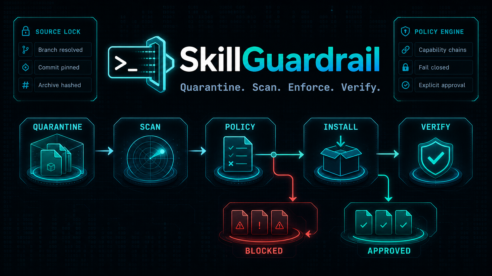
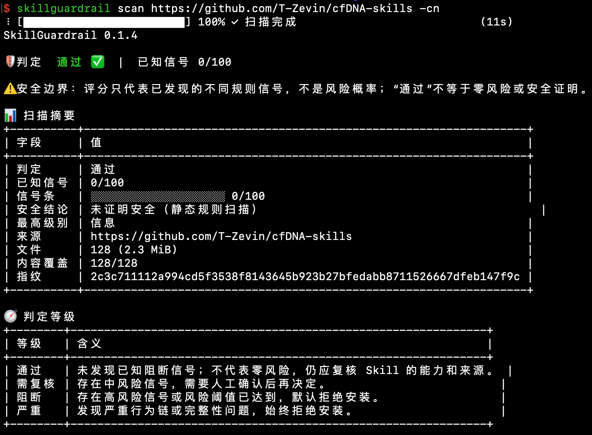
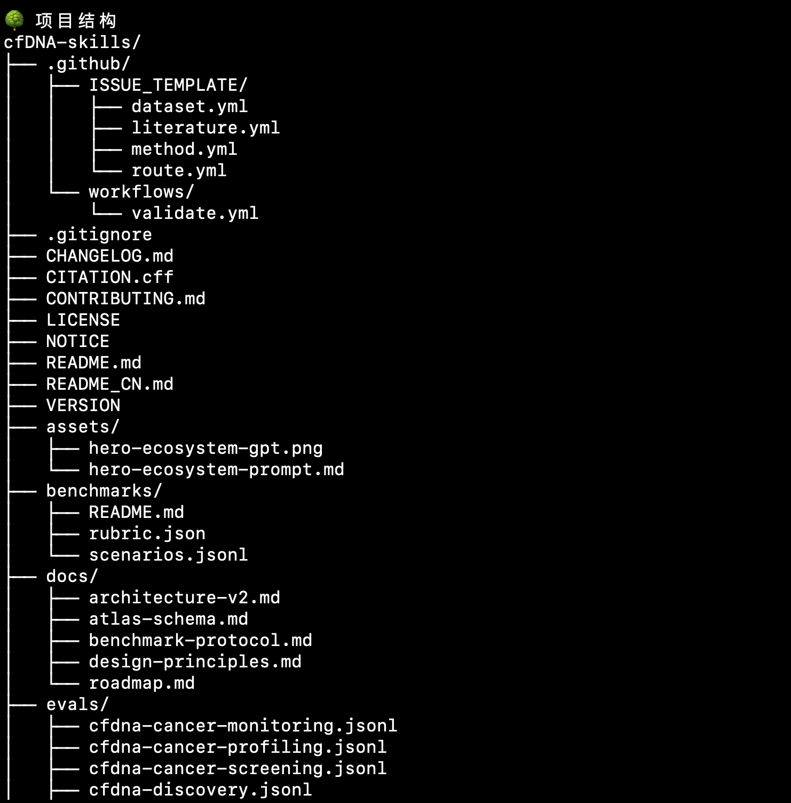
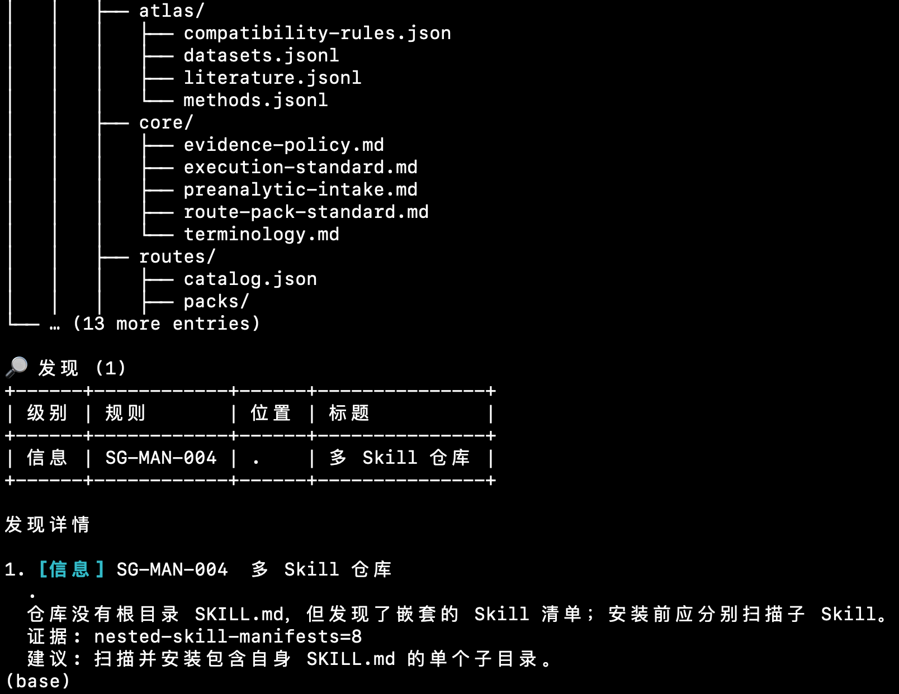
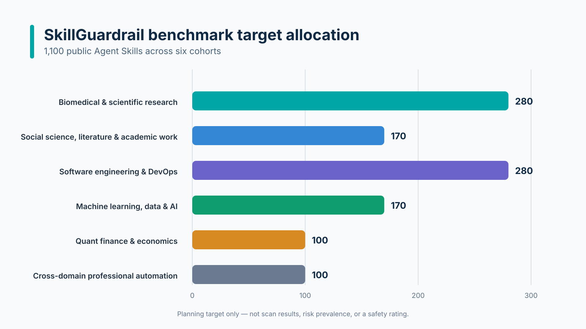

<h1 align="center">SkillGuardrail</h1>

<p align="center">
  简体中文 · <a href="README.md">English</a>
</p>

<p align="center">
  <a href="https://github.com/T-Zevin/SkillGuardrail/actions/workflows/ci.yml"></a>
  <a href="https://github.com/T-Zevin/SkillGuardrail/releases"></a>
  <a href="https://github.com/T-Zevin/SkillGuardrail/releases"></a>
  <a href="go.mod"></a>
  <a href="LICENSE"></a>
  <a href="#平台支持"></a>
</p>



**别把 GitHub 上的 Skill 直接装进 Agent。先隔离、扫描、判定，再安装。**

SkillGuardrail 是面向 Codex、Claude Code、Cursor、Gemini CLI 与 OpenClaw 的开源 Agent Skill 安全护栏：它在不运行包内代码的前提下检查不可信 Skill，输出可解释的策略判定，并将已批准的安装绑定到来源 commit、内容指纹与外部 receipt。

> [!IMPORTANT]
> `PASS` 只代表当前规则未发现已知阻断信号，不是零风险或安全认证。未知来源仍应最小权限、沙箱运行并人工复核。

| 隔离优先 | 策略判定 | 可验证安装 |
|:---|:---|:---|
| 不执行 Skill 脚本、解释器或安装钩子。 | 结合规则信号与能力链给出 `PASS / REVIEW / BLOCK / CRITICAL`。 | 安装后可检查文件是否偏离当时审核的来源与指纹。 |

## 为什么需要它？

Skill 不只是 Markdown：它可以带入指令、脚本、依赖、网络访问与外部内容。SkillGuardrail 重点检查提示注入、敏感凭据访问、网络外传、远程下载、危险命令、持久化、混淆、二进制，以及“敏感读取 + 外联”“解码 + 执行”等能力链。

```text
不可信来源 → 私有隔离区 → 静态扫描 → 策略判定 → 明确批准 → 原子安装 → 后续验证
```

完整规则见 [规则目录](docs/rules.md)，安全边界与已知限制见 [威胁模型](docs/threat-model.md)。

## 安装

```bash
# Homebrew（macOS / Linux）
brew install T-Zevin/tap/skillguardrail

# 或从源码安装（Go 1.23+）
go install github.com/T-Zevin/SkillGuardrail/cmd/skillguardrail@latest
```

也可从 [GitHub Releases](https://github.com/T-Zevin/SkillGuardrail/releases) 下载二进制，并校验 `checksums.txt`。

### 平台支持

macOS、Linux、Windows 均支持扫描和报告。受控 `install` / `verify` 当前在 macOS 与 Linux 启用；Windows 用户可以扫描后手动安装已复核的文件。

## 30 秒上手

```bash
# 扫描本地 Skill
skillguardrail scan ./my-skill -cn

# 扫描公开 GitHub 仓库
skillguardrail scan -cn https://github.com/owner/repository

# 输出 JSON 或 SARIF，供 CI 使用
skillguardrail scan ./my-skill --format json
skillguardrail scan ./my-skill --format sarif --output skillguardrail.sarif

# 仅在通过人工确认后受控安装到 Codex
skillguardrail install https://github.com/owner/repository --target codex --yes

# 验证已安装 Skill 是否被改动
skillguardrail verify skill-name --target codex
```

远程来源会先解析为不可变 commit，再下载到私有隔离区。交互终端会显示进度条；网络较慢时可增加 `--timeout 25m`。默认只接受公开 GitHub HTTPS 仓库；根目录有一个 Skill，或仅包含一个嵌套 Skill 时可直接扫描。

## 判定含义

| 判定 | 含义 | 默认行为 |
| --- | --- | --- |
| `PASS` | 未发现已知阻断信号；仍需核对来源和能力 | 可继续人工决策 |
| `REVIEW` | 中风险能力或累计信号需要确认 | 要求明确决定 |
| `BLOCK` | High 信号或风险阈值达到 | 拒绝受控安装 |
| `CRITICAL` | 严重行为链或完整性问题 | 始终拒绝 |

风险分数统计的是不同规则信号，**不是**被攻击的概率。扫描不完整时，受控安装会默认失败。

## 使用案例

以下案例扫描公开仓库 [`T-Zevin/cfDNA-skills`](https://github.com/T-Zevin/cfDNA-skills)。截图中的 `PASS` 表示未命中已知阻断信号，不代表该仓库被证明安全。

```bash
skillguardrail scan -cn https://github.com/T-Zevin/cfDNA-skills
```

### 扫描摘要：判定、覆盖率与指纹

<p align="center">
  
</p>

### 项目结构：工具实际审查了什么

<p align="center">
  
</p>

### 多 Skill 仓库：信息提示，不等于恶意

<p align="center">
  
</p>

多个嵌套 `SKILL.md` 会触发信息级 `SG-MAN-004`：应分别扫描和安装具体子 Skill，而不应把正常的多 Skill 仓库直接误判为高风险。

## 1,100+ 跨领域基准计划

SkillGuardrail 正在建立可复现的公开 Skill 安全基准，覆盖生物医学与科研、社科与文献综述、IT/DevOps、机器学习与数据、量化金融和通用自动化。

- 当前试运行队列：108 个固定 commit 的科研与 cfDNA Skill；
- 正式目标：至少 1,100 个公开 Skill；
- 每个非 `PASS` 结果必须人工复核；
- 报告会按领域和来源仓库分层，绝不把“规则命中”表述为“恶意”。

<p align="center">
  
</p>

> 图中是锁定基准前的**目标样本分层**，不是已扫描数量、风险命中率或安全评级。完成全部扫描及人工复核后，才会另外发布判定分布、规则频率和误报复核数据。

查看 [基准方法](benchmarks/README.md) 与 [1,100+ 路线图](benchmarks/ROADMAP.md)。

## 常用参数

| 参数 | 用途 |
| --- | --- |
| `-cn` | 中文人类可读报告；可放在来源前或后。 |
| `--format text\|json\|sarif` | 文本、机器可读 JSON 或 SARIF。 |
| `--output PATH` | 将报告写入文件。 |
| `--fail-on high` | 将 High/critical 作为脚本或 CI 的失败阈值。 |
| `--timeout 25m` | 为慢速 GitHub 下载延长总超时。 |
| `--no-color` | 仅用于日志或 CI 的纯文本输出。 |

完整参数请运行：

```bash
skillguardrail --help
skillguardrail scan --help
skillguardrail install --help
skillguardrail verify --help
```

## 相关工作与许可证

本项目是独立实现，设计参考 [NVIDIA SkillSpector](https://github.com/NVIDIA/SkillSpector)、[Cisco AI Defense Skill Scanner](https://github.com/cisco-ai-defense/skill-scanner)、[Agent Skills 规范](https://agentskills.io/specification)与 [OWASP Agentic Skills Top 10](https://owasp.org/www-project-agentic-skills-top-10/)，不代表上述项目的认证或背书。

基于 [Apache License 2.0](LICENSE) 发布。
